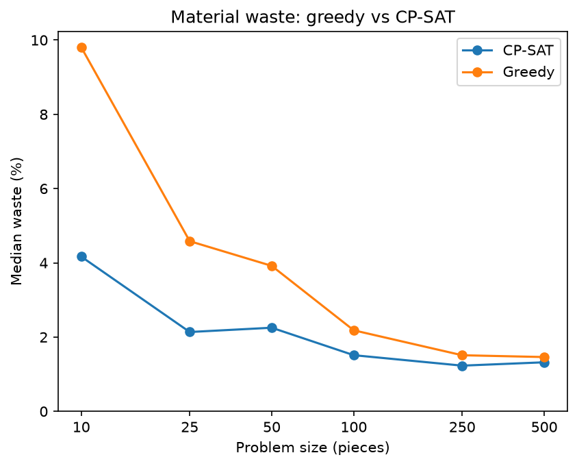
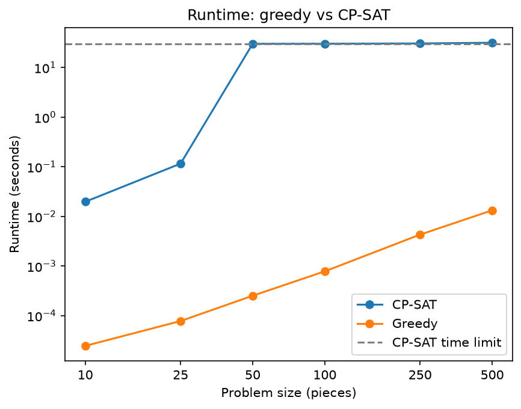
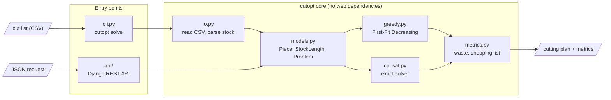

# Timber Cut Optimizer

[](https://github.com/DRencsok/TimberCutOpt/actions/workflows/ci.yml)

Takes the cut list for a timber construction job and works out which stock boards to buy and
how to cut them, so as little timber as possible ends up as offcuts. It has two solvers, a fast
greedy heuristic and an exact CP-SAT model, and runs from the command line or as a REST API.

On small jobs the exact solver cuts waste from 9.8 % to 4.2 %. On 500-piece jobs the greedy
heuristic gets within 0.3 points of it in under 20 ms.

Live demo: [timbercutopt.onrender.com/api/docs](https://timbercutopt.onrender.com/api/docs/)
(free hosting, so the first request can take about 30 s while the server wakes up)

Built with Python, Google OR-Tools (CP-SAT), Django REST Framework, Docker and GitHub Actions,
deployed on Render.

## Why I built this

I wanted to learn how to build a whole application, not just a script. I picked a timber
problem because I study timber construction, and this is a tool my classmates and I could
actually use.

Most of it was new to me: the greedy algorithm, Google's OR-Tools and its CP-SAT solver,
Django REST Framework, Docker and writing a Dockerfile, and setting up CORS. The hardest part
was the CP-SAT model. It's built from 2D tables of yes/no variables (which piece goes on which
board, which stock length each board is), and getting the constraints between them right
took the most work.

## The problem

Building plans list the pieces a job needs: 16 wall studs at 1950 mm, 7 rafters at 2150 mm,
and so on. Timber yards don't sell those lengths. They sell standard stock lengths (usually
2400, 3600, 4800 and 6000 mm), and every piece has to be sawn out of one. Done by hand, this
usually means over-ordering. It's the one-dimensional cutting stock problem, which is NP-hard.

| Term | Meaning |
|---|---|
| Section | The board's cross-section and grade, e.g. `47x100 C24`: 47 mm thick, 100 mm wide, strength class C24. Pieces can only be cut from stock of the same section. |
| Stock length | A length the timber yard sells, e.g. 4800 mm. |
| Kerf | The width of wood the saw blade turns into dust on every cut, usually 2–4 mm. |
| Offcut | What's left of a board after all its pieces are cut. |

Timber is sawn at a nominal 50 mm and then dried and planed, which is why a "2×4" is really
47×100 in the UK/EU (38×89 in North America).

## Example

Cut list (`examples/shed.csv`):

```csv
label,length,quantity,section
wall stud,1950,16,47x100 C24
nogging,550,12,47x100 C24
rafter,2150,7,47x150 C24
```

```
$ cutopt solve examples/shed.csv
                               Cutting Plan
+------------------------------------------------------------------------+
| Id | Section    | Stock | Cuts                           | Offcut (mm) |
|----+------------+-------+--------------------------------+-------------|
| 1  | 47x150 C24 | 4800  | rafter 2150 x2                 |     494     |
| 2  | 47x150 C24 | 4800  | rafter 2150 x2                 |     494     |
| 3  | 47x150 C24 | 4800  | rafter 2150 x2                 |     494     |
| 4  | 47x150 C24 | 2400  | rafter 2150                    |     247     |
| 5  | 47x100 C24 | 6000  | wall stud 1950 x3              |     141     |
| 6  | 47x100 C24 | 6000  | wall stud 1950 x3              |     141     |
| 7  | 47x100 C24 | 6000  | wall stud 1950 x3              |     141     |
| 8  | 47x100 C24 | 6000  | wall stud 1950 x3              |     141     |
| 9  | 47x100 C24 | 6000  | wall stud 1950 x3              |     141     |
| 10 | 47x100 C24 | 6000  | wall stud 1950, nogging 550 x7 |     176     |
| 11 | 47x100 C24 | 3600  | nogging 550 x5                 |     835     |
+------------------------------------------------------------------------+
          Shopping List
+--------------------------------+
| Section    | Length | Quantity |
|------------+--------+----------|
| 47x100 C24 | 3600   | 1        |
| 47x100 C24 | 6000   | 6        |
| 47x150 C24 | 2400   | 1        |
| 47x150 C24 | 4800   | 3        |
+--------------------------------+
                               Summary
+--------------------------------------------------------------------+
| Boards | Stock length total | Piece length total | Waste | Waste % |
|--------+--------------------+--------------------+-------+---------|
| 11     | 56400              | 52850              | 3550  | 6.29    |
+--------------------------------------------------------------------+
```

`--solver cp_sat` switches to the exact solver. It stops after 10 s by default (change it with
`--time-limit`) and returns the best plan found so far. `cutopt solve --help` lists all options.

## Running it locally

Needs Python 3.12+ and [uv](https://docs.astral.sh/uv/).

```bash
git clone https://github.com/DRencsok/TimberCutOpt.git
cd TimberCutOpt
uv sync
uv run pytest
uv run cutopt solve examples/shed.csv
```

## REST API

`POST /api/solve/` takes the same cut list as JSON and returns the boards, the shopping list
and a summary. The easiest way to try it is the
[Swagger UI](https://timbercutopt.onrender.com/api/docs/): open `POST /api/solve/`, click
Try it out, then Execute.

```bash
curl -X POST https://timbercutopt.onrender.com/api/solve/ \
  -H "Content-Type: application/json" \
  -d '{
    "pieces": [
      {"label": "wall stud", "length": 1950, "quantity": 16, "section": "47x100 C24"},
      {"label": "rafter", "length": 2150, "quantity": 7, "section": "47x150 C24"}
    ],
    "solver": "cp_sat"
  }'
```

Only `pieces` is required. Requests are capped at 500 pieces and a 20 s time limit, and
throttled to 20 per minute per client.

To run the API locally with Docker (docs at http://localhost:8000/api/docs/):

```bash
docker build -t timbercut-api .
docker run --rm -p 8000:8000 -e DJANGO_SECRET_KEY=local-dev-key -e DJANGO_ALLOWED_HOSTS=localhost timbercut-api
```

## How it works

### Solvers

- Greedy (First-Fit Decreasing): sort the pieces longest first and put each one on the first
  board it fits on, opening a new board when none fits. Very fast and usually close to
  optimal, but with no guarantee.
- CP-SAT (Google OR-Tools): a constraint model that assigns pieces to boards and picks a stock
  length for each board, minimising the total timber bought. It can prove the plan is optimal
  on small and medium jobs.

### Modelling decisions

- Kerf is modelled exactly. *n* pieces on a board need *n − 1* cuts between them, plus one
  more if an offcut is left. So a 2400 mm piece fits a 2400 mm board, but two 1200 mm pieces
  with a 3 mm kerf don't.
- Each section is solved separately. Different sections can never share a board, so a job
  splits into independent smaller problems, which also makes CP-SAT faster.
- CP-SAT never does worse than greedy. Greedy runs first, its plan is the starting point and
  its board count is the most boards CP-SAT may use.
- The core has no web dependencies. The solvers are a plain Python package that never imports
  Django, so the CLI, the API and the benchmark are thin layers on the same code, and the core
  tests run without a server.

Lengths are whole millimetres (CP-SAT only accepts integers), and the input objects are
immutable so one solver can't change the problem for the other. The full decision log is in
[docs/DECISIONS.md](docs/DECISIONS.md).

### Known limitations

- Stock supply is assumed unlimited. Quantity limits aren't enforced yet.
- The same stock lengths apply to every section in a cut list.

## Results: greedy vs CP-SAT

Each point is the median of 3 random problems per size (one section, lengths 300–3000 mm).
CP-SAT had a 30 s time limit.



CP-SAT wastes less at every size, and the gap is biggest on small jobs (4.2 % vs 9.8 % at
10 pieces). Both solvers always used the same number of boards. CP-SAT saves timber by picking
shorter stock lengths, about 1.2 m per problem, which barely matters on a large job: from 250
pieces up, greedy is within 0.3 points.



Greedy takes under 20 ms even at 500 pieces. CP-SAT solves small problems in under 0.2 s, but
from 50 pieces up it usually hits the 30 s limit and returns its best plan without proving it
optimal. So CP-SAT is worth it on small and medium cut lists, and greedy is the better choice
on large ones.

To reproduce:

```bash
uv sync --group bench
uv run python benchmarks/run.py
uv run python benchmarks/plot.py
```

> [!WARNING]
> `benchmarks/run.py` takes about 15 minutes. From 50 pieces up, most CP-SAT runs use the
> full 30 s limit, and each problem is solved twice.

## Architecture



## Project structure

```
src/cutopt/      core package: models, solvers, metrics, CSV input, CLI
api/             Django REST API (DRF, OpenAPI docs)
tests/           pytest tests for the core, the CLI and the API
examples/        sample cut lists
benchmarks/      greedy vs CP-SAT comparison
Dockerfile       production image for the API (gunicorn + WhiteNoise)
```

## Roadmap

- Automatic deploys after CI passes
- Web frontend with visual cutting diagrams
- User accounts, so cut lists and plans can be saved
- Stock quantity limits and different stock lengths per section
- 2D sheet goods (plywood/OSB panels)
